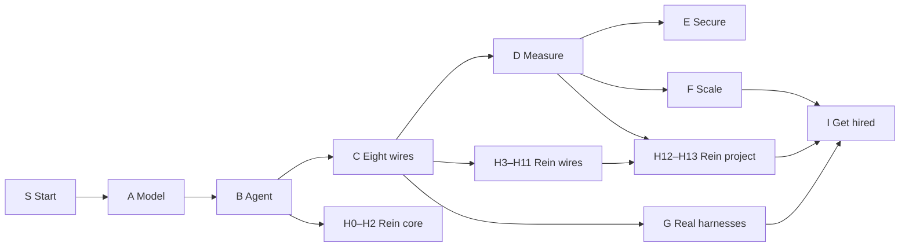

# HARNESSED: curriculum

Status: v1 (Phase 0). Owner approval is part of the Phase 0 exit gate.
`course.json` is the single source of truth for modules, objectives,
prerequisites, terms, failure families and counts. The second half of this
file is generated from it; the first half explains the choices.

---

## 1. Who the learner is

- **Starts with:** basic Python (functions, lists, dicts, loops, reading a
  traceback) and the ability to run a command in a terminal. No AI or ML
  background.
- **Ends as:** someone who can build, measure, debug and secure an agent
  harness, show the evidence in public, and defend it in applied-AI,
  agent-infrastructure and evals interviews.
- **Typical pace:** 8–15 focused hours a week. The lesson time on the default
  path is listed in the generated block below; practice (cards, katas, the
  daily shift), the portfolio project and interview rehearsal roughly double it.
- **Experienced engineers** take the placement check and skip ahead. Cards for
  skipped modules still enter their deck, so gaps surface in review instead of
  in an interview.

Honest framing: no course guarantees an offer. HARNESSED makes the learner's
evidence real and visible; the hiring decision is someone else's.

## 2. The arc

1. **Start (S0): the thesis in the first 25 minutes.** The learner replays a
   run that claims "done" and isn't, adds one harness setting, runs 20 seeded
   trials, and sees the pass rate move with the model unchanged. *Same model,
   different harness, different results* is felt before anything is defined
   in depth. S0 also teaches the vocabulary of a run (agent, harness, tool,
   run, trace, trial, seed, pass rate, failure family) and how the course works.
2. **Part A, the model:** what a model is and is not, ending on why it can't
   be trusted alone (A7). Structured outputs (A5) come before tools because
   tool inputs are JSON Schema.
3. **Part B, from chatbot to agent:** tools, the loop, what a harness is, and
   the Turn Clock. Rein's first two build steps (H0–H2) slot in right after the
   loop, so learners write a working agent in week one.
4. **Part C, the eight wires, in turn order.** One module per wire, two for the
   wires that carry the most weight (context: budget, compaction and memory,
   caching; tools: design, MCP/skills; permissions: policy, sandbox). The order
   is the order of one turn around the clock, so the curriculum *is* the
   mnemonic: Control, Context, Loop, Errors, Tools, Permissions, Verification,
   Observability.
5. **A build sprint inside Part C.** Once the tool and sandbox modules are done,
   Rein steps H3–H8 run back to back (their theory is already taught), then
   H9–H11 follow verification.
6. **Parts D–F: measure, secure, scale.** Evals before security and scale,
   because every later claim needs a number with an interval.
7. **Part G, real harnesses:** dated teardowns of Claude Code and Codex, a
   guided reading of a real open-source harness (mini-swe-agent), and the daily
   craft.
8. **H12–H13 and Part I:** Rein becomes a project with real eval numbers; the
   learner turns evidence into a portfolio and rehearses interviews.

## 3. Module kinds

Every module has a kind, and the checker enforces each kind's beats and assets
(`course.json` → `kinds`).

| Kind | Beats | Must include |
|---|---|---|
| core | Break → See → Fix → Prove → Keep | incident, lab, kata, Prove experiment, cards, say-it |
| concept | Break → See → Lab → Check → Keep | incident, lab, prediction check, cards, say-it |
| build (Rein steps) | Break → See → Fix → Prove → Keep | incident (the previous step's Rein failing on a new tape), `hx-step`, checkpoint + Prove, cards, say-it |
| guide | See → Do → Keep | cards, say-it |
| career | See → Do → Keep | at least one drill (say-it, design, timed kata or trace debugging) |
| primer | See → Fix → Keep | one kata, cards |

The Keep beat always has the module's **law** (one line to memorize), cards,
interview prompts and a portfolio note. Concept modules still Prove something
when it is cheap (A6 measures effort on the Bench), but they aren't required to.

## 4. Assessment design

- **Objectives are measurable** ("Write…", "Compute…", "Predict…", "Name…").
  Each objective has an id (`B2.o3`). Every assessment item in a module
  declares which objective(s) it covers (`data-objective="B2.o3"`), and
  `check_content.py` fails if any objective has none.
- **Evidence levels** feed the readiness radar: passing checks and cards is
  L1 (can explain), katas and build steps are L2 (have built), Prove
  experiments, evals and design drills are L3 (can defend with data).
- **Prediction first.** Break beats ask the learner to commit to a prediction
  before the replay; the gap between prediction and result is the hook.
- **Retrieval, spaced and interleaved.** Cards from every module join one
  deck. The daily on-call shift mixes an incident from any family seen so
  far, the due cards across wires, and one micro-kata or say-it drill.
- **Misconceptions are confronted, not just corrected.** Each module lists the
  misconceptions it targets; wrong options in checks and cards are written from
  that list, and each explains why the tempting answer is tempting.

## 5. Term order (no term before it is taught)

Each planned term has exactly one owning module (`course.json` → `terms`).
A module may use a term only if it owns it or the owner is one of its
ancestors in the prerequisite graph. `check_content.py` enforces this on
visible prose using the glossary's surface forms. Common English words that
are also terms ("task", "session", "event") are checked only where they're
tagged as terms. Primers are standalone: they require only S0 and may
re-define a few terms locally (`local_terms`) without taking ownership.

This rule already changed the plan in Phase 0: a dry run over the objectives
found 22 uses before teaching. "Tool" moved into S0's starter vocabulary,
"sub-agent" into C11 (the independent reviewer is the first sub-agent learners
meet), "exfiltration" into C10, and F4, G3 and the Interview Room (now I5)
gained prerequisites.

## 6. Changes from the SPEC §5 draft, and why

| Change | Why |
|---|---|
| **Added S0 "Same model, different harness"** (concept, 25 min) | The thesis has to land before chapter 3; S0 makes it the first thing a learner does, and doubles as the polished 10-minute first-session path for Phase 7. |
| **Part A reordered**: structured outputs → A5, reasoning → A6, "why a model alone is unreliable" → A7 | Tools (B1) need JSON Schema first; ending Part A on unreliability motivates Part B. |
| **Part C in turn order** (Control, Context ×3, Loop, Errors, Tools ×2, Permissions ×2, Verification, Observability) | SPEC §3.1 says one order everywhere, including lessons; the draft's Part C order contradicted it. The curriculum becomes the mnemonic. |
| **Compaction/memory and prompt caching split** (C3, C4) | Together they exceed the ~900-word beat budget; caching has its own lab, kata and incident. |
| **Added F7 "Model migrations"** | Research for Phase 0 found real harness breakage from model changes in 2026 (removed prefill, rejected parameters, changed thinking controls). Migrating a harness to a new model is routine work for this job and needs regression evals, so it sits after D3. |
| **F6 gains eval containment** | Environments that can reach the outside world are now a documented risk; a contained sandbox is part of the job. |
| **C1's hook objective requires failing closed** | A hook that fails open is a rule that silently isn't enforced. |
| **New interactions**: `hx-check` (prediction check / quiz), `hx-sort` (sort items into buckets) | Concept modules need a prediction check, and the book's "model or harness?" and "which wire?" labs are sorting tasks. Both are small. |
| **G3 repository chosen: mini-swe-agent v2.4.6 (MIT)** | Its core loop is about 190 lines of Python with tests; the other candidates' loops are 900–2,500 lines or not tool loops. |
| **Rein build kept in the book's step order** | Each step's diff applies to the previous file; the steps are interleaved into the path as soon as their theory is taught. |
| **Primers require S0** | Every learner does S0 first, so primers can say "agent" and "tool". |
| **Basic Python is a stated prerequisite** | The course is code-first; a Python-basics primer is in the backlog. |
| **Added I4 "Capstone: Rein in Rust"** (career, after the portfolio projects; the Interview Room becomes I5 and "Twelve weeks after" I6) | Owner request (2026-10-10, D-046). Reimplementing the engine spec in a second language and proving it with the same golden traces is strong portfolio and interview evidence, and it tests the spec itself. Rust is the suggested language; the parity runner accepts any command, so another language works too. It comes before the Interview Room so learners can tell its story there. |

<!-- BEGIN GENERATED: tools/render_curriculum.py -->
## Generated from course.json

Do not edit this block by hand: change `course.json`, then run `python tools/render_curriculum.py`.

- **70 modules** (29 core, 11 concept, 11 build, 3 guide, 6 career, 10 primer) in 11 parts, 271 objectives, 336 planned terms, 35 failure families.
- Lesson time on the default path: about 46 hours (all modules including primers: about 50 hours), before practice, portfolio and interview work.

### Default path

S0 → A1 → A2 → A3 → A4 → A5 → A6 → A7 → B1 → B2 → H0 → H1 → H2 → B3 → B4 → C1 → C2 → C3 → C4 → C5 → C6 → C7 → C8 → C9 → C10 → H3 → H4 → H5 → H6 → H7 → H8 → C11 → H9 → H10 → H11 → C12 → D1 → D2 → D3 → H12 → E1 → E2 → F1 → F2 → F3 → F4 → F5 → F6 → F7 → G1 → G2 → G3 → G4 → H13 → I1 → I2 → I3 → I4 → I5 → I6

### Module map

#### Part S — Start here

| Code | Module | Kind | Wires | Needs | Min | Law |
|---|---|---|---|---|---|---|
| S0 | Same model, different harness | concept | Verification Loop | — | 25 | Same model, different harness, different results. |

#### Part A — The model

| Code | Module | Kind | Wires | Needs | Min | Law |
|---|---|---|---|---|---|---|
| A1 | What a model does | concept | Verification | S0 | 30 | A model predicts; it doesn't know. |
| A2 | Tokens and the context window | concept | Context | A1 | 30 | Everything on the desk costs tokens. |
| A3 | The stateless model | core | Context Loop | A2 | 40 | The messages array is the memory. |
| A4 | The API call on the wire (dated) | core | Loop Observability | A3 | 50 | Read the whole reply: every block, every stop reason. |
| A5 | Structured outputs and schemas (dated) | core | Tools | A4 | 45 | Valid isn't true: check the shape, then the meaning. |
| A6 | Reasoning and effort as harness knobs (dated) | concept | Loop | A4 | 35 | Effort is a dial with a price. |
| A7 | Why a model alone is unreliable | concept | Verification Errors | A4 | 30 | Small errors multiply; the harness has to catch them. |

#### Part B — From chatbot to agent

| Code | Module | Kind | Wires | Needs | Min | Law |
|---|---|---|---|---|---|---|
| B1 | Tools give the model hands (dated) | core | Tools Permissions | A5, A7 | 50 | The model asks; the harness acts. |
| B2 | The agent loop | core | Loop | B1 | 60 | Every run needs more than one exit. |
| B3 | What a harness is (dated) | concept | Control Loop Tools Permissions Context Errors Verification Observability | B2 | 35 | Agent = Model + Harness. |
| B4 | The Turn Clock | concept | Control Context Loop Errors Tools Permissions Verification Observability | B3 | 30 | One turn, eight wires, one order. |

#### Part C — The eight wires

| Code | Module | Kind | Wires | Needs | Min | Law |
|---|---|---|---|---|---|---|
| C1 | Control plane: instructions as law (dated) | core | Control | B4 | 55 | Words guide, code enforces. |
| C2 | Context budget (dated) | core | Context | B4 | 50 | The smallest window that works. |
| C3 | Compaction and memory (dated) | core | Context | C2 | 50 | Summarize the story, keep the commitments. |
| C4 | Prompt caching (dated) | core | Context | C2 | 45 | Stable first, changing last. |
| C5 | Loop state and stopping well (dated) | core | Loop | B4 | 55 | Close the books before you stop. |
| C6 | Errors are the main path (dated) | core | Errors | B4 | 55 | Errors are the main path. |
| C7 | Tool design is agent UX | core | Tools | B4 | 55 | A tool is a user interface for a model. |
| C8 | MCP, skills and tool scale (dated) | core | Tools Context | C7 | 50 | Load the menu, not the kitchen. |
| C9 | Permissions (dated) | core | Permissions | C7 | 55 | Judge the action and its target. |
| C10 | Sandboxes: blast walls (dated) | core | Permissions | C9 | 50 | Assume the wall will be tested. |
| C11 | Verification: done is a claim | core | Verification | B4 | 55 | “Done” is a claim. |
| C12 | Observability: traces you can read (dated) | core | Observability | B4 | 50 | If it isn't in the trace, it didn't happen. |

#### Part D — Measure

| Code | Module | Kind | Wires | Needs | Min | Law |
|---|---|---|---|---|---|---|
| D1 | Eval anatomy (dated) | core | Verification | C11 | 50 | No number, no claim. |
| D2 | Statistics for a random system (dated) | core | Verification | D1 | 55 | One run is an anecdote. |
| D3 | Evals in practice (dated) | core | Verification Observability | D2 | 55 | Grade the grader. |

#### Part E — Secure

| Code | Module | Kind | Wires | Needs | Min | Law |
|---|---|---|---|---|---|---|
| E1 | Prompt injection and the lethal trifecta (dated) | core | Permissions | C10 | 55 | Remove a leg; don't ask nicely. |
| E2 | Defense in layers (dated) | core | Permissions Tools | E1, C8 | 50 | Every layer fails sometimes; stack them. |

#### Part F — Scale

| Code | Module | Kind | Wires | Needs | Min | Law |
|---|---|---|---|---|---|---|
| F1 | Many agents: when and how (dated) | core | Loop Context Verification | C3, C11 | 55 | Add agents for a reason, not for a picture. |
| F2 | Long-running agents (dated) | core | Context Loop Verification | C3, F1 | 50 | Leave the desk ready for the next shift. |
| F3 | Managed agents: the harness as a service (dated) | concept | Loop Permissions Context | F2, C10 | 35 | Keep the state outside the process. |
| F4 | Cost and latency engineering (dated) | core | Observability Context | C4, D2, A6 | 50 | Price the outcome, not the call. |
| F5 | Production: agents that survive real traffic (dated) | core | Errors Loop Observability | C5, C6 | 55 | Assume the process dies mid-step. |
| F6 | Environments: harnesses that train and test models (dated) | core | Verification Permissions | D3, C10 | 60 | The grader is the spec. |
| F7 | Model migrations: when the model changes under you (dated) | core | Loop Verification Control | D3, A6 | 50 | New model, old assumptions: test them again. |

#### Part G — Real harnesses

| Code | Module | Kind | Wires | Needs | Min | Law |
|---|---|---|---|---|---|---|
| G1 | Inside Claude Code, wire by wire (dated) | concept | Control Context Loop Errors Tools Permissions Verification Observability | C1, C2, C5, C6, C7, C8, C9, C11, C12 | 40 | Read real harnesses wire by wire. |
| G2 | Codex and open harnesses: what everyone agrees on (dated) | concept | Loop Permissions Context Tools | G1, F3 | 40 | Laws are what everyone agrees on; the rest is taste. |
| G3 | Reading a real harness repository (dated) | concept | Loop Tools Observability | G1, D1 | 60 | Find the loop first. |
| G4 | The daily craft | core | Observability Verification Control | G1, D3 | 50 | Name the failure before you fix it. |

#### Part H — Build Rein

| Code | Module | Kind | Wires | Needs | Min | Law |
|---|---|---|---|---|---|---|
| H0 | Rein setup | guide | Loop | S0 | 20 | Script first, then go live. |
| H1 | Rein 1: talk to a model | build | Loop | H0, A4 | 35 | One interface, many models. |
| H2 | Rein 2: one tool and the loop | build | Loop Tools | H1, B2 | 40 | The model asks; the harness acts. |
| H3 | Rein 3: real tools inside a wall | build | Tools Permissions | H2, C7, C10 | 45 | Assume the wall will be tested. |
| H4 | Rein 4: the permission gate | build | Permissions | H3, C9 | 40 | Judge the action and its target. |
| H5 | Rein 5: a trace | build | Observability | H4, B4 | 35 | If it isn't in the trace, it didn't happen. |
| H6 | Rein 6: a context budget | build | Context | H5, C2 | 40 | The smallest window that works. |
| H7 | Rein 7: retries and a breaker | build | Errors | H6, C6 | 45 | Errors are the main path. |
| H8 | Rein 8: guards that stop the run well | build | Loop | H7, C5 | 40 | Every run needs more than one exit. |
| H9 | Rein 9: the verification gate | build | Verification | H8, C11 | 40 | “Done” is a claim. |
| H10 | Rein 10: project rules | build | Control | H9, C1 | 35 | Words guide, code enforces. |
| H11 | Rein 11: a reviewer sub-agent | build | Verification Loop | H10, C11 | 45 | Independence is designed, not assumed. |
| H12 | From one file to a project (dated) | guide | Verification Observability | H11, D2 | 90 | Ship the numbers with the code. |
| H13 | Rein extensions, ranked | guide | Control Context Loop Errors Tools Permissions Verification Observability | H12 | 30 | Extend where the evidence points. |

#### Part I — Get hired

| Code | Module | Kind | Wires | Needs | Min | Law |
|---|---|---|---|---|---|---|
| I1 | The job map (dated) | career | Observability Verification | B4 | 30 | Evidence beats adjectives. |
| I2 | Readiness self-assessment | career | Control Context Loop Errors Tools Permissions Verification Observability | I1 | 30 | Claim only what you can show. |
| I3 | Four portfolio projects | career | Verification Observability | H12, I2 | 45 | A result is a number, an interval and a method. |
| I4 | Capstone: Rein in Rust | career | Control Context Loop Errors Tools Permissions Verification Observability | H12, I3 | 60 | Same spec, same traces, any language. |
| I5 | Interview Room | career | Control Context Loop Errors Tools Permissions Verification Observability | I2, I3, D2, G4, F5 | 120 | Walk the clock out loud. |
| I6 | Twelve weeks after the course | career | Observability | I5 | 30 | Practice in public, on a schedule. |

#### Part T — Toolbelt

| Code | Module | Kind | Wires | Needs | Min | Law |
|---|---|---|---|---|---|---|
| T1 | Python typing and dataclasses | primer | — | S0 | 20 | Types are documentation the checker reads. |
| T2 | asyncio | primer | — | S0 | 25 | Await what waits; don't block the loop. |
| T3 | subprocess and signals | primer | — | S0 | 20 | Every child process needs a timeout. |
| T4 | JSON Schema in depth | primer | — | S0 | 20 | Say what's allowed, not just what's expected. |
| T5 | HTTP and SSE streaming | primer | — | S0 | 20 | A stream is a message in pieces. |
| T6 | pytest | primer | — | S0 | 20 | A test that can't fail proves nothing. |
| T7 | Containers | primer | — | S0 | 25 | A container is a process with a smaller view. |
| T8 | git for agent work | primer | — | S0 | 20 | Commits are the undo button. |
| T9 | Linux processes | primer | — | S0 | 20 | Know who your process is and what it can touch. |
| T10 | Threads vs. async | primer | — | S0 | 20 | Concurrency is about waiting, not speed. |

### Module details

#### S0 · Same model, different harness

kind **concept** · slug `same-model-different-harness` · Break incident: *False “done”* (Verification) · book: start, c7

By the end you can:

- `S0.o1` Replay an agent run and describe it as a sequence of model calls and tool actions.
- `S0.o2` Predict whether a run's “done” is real before replaying it, then check your prediction.
- `S0.o3` Change one harness setting and measure its effect over 20 seeded trials as a pass rate.
- `S0.o4` State the course thesis with your own numbers: same model, different harness, different results.
- `S0.o5` Find your way around the course: the five beats, the eight wires, your Harness Board, and progress export.

Misconceptions to confront: “A better model is the only way to get better results.” “If the agent says it's done, it's done.” “One good run proves the setup works.”

New terms: agent, harness, tool, run, trace, trial, seed, pass rate, failure family, Harness Board

Interactions: `hx-replay`, `hx-bench`, `hx-board`, `hx-check`, `hx-placement`

#### A1 · What a model does

kind **concept** · slug `what-a-model-does` · Break incident: *The confident lie* (Verification) · book: c1, c4

By the end you can:

- `A1.o1` Explain next-token prediction: the model scores every possible next token and a sampler picks one.
- `A1.o2` Predict how temperature changes the spread of outputs, then check it in the Sampler.
- `A1.o3` Explain why a fluent, confident answer can be false, and why fluency is not evidence.
- `A1.o4` Distinguish training from inference, and say which one a harness engineer controls.

Misconceptions to confront: “The model looks facts up.” “Temperature 0 makes the model correct and repeatable.” “The model learns from our conversation as we talk.”

New terms: language model, token, next-token prediction, probability, sampling, temperature, hallucination, training, inference, weights

Interactions: `hx-sampler`, `hx-check`, `hx-replay`

#### A2 · Tokens and the context window

kind **concept** · slug `tokens-and-the-window` · Break incident: *Context flood* (Context) · book: c2

By the end you can:

- `A2.o1` Estimate the token count of a text with the course's rule of thumb, then check it in the Tokenizer.
- `A2.o2` Explain the context window as one fixed-size desk shared by instructions, history, tool results and the reply.
- `A2.o3` Distinguish the input limit from the output limit, and predict what happens when each is hit.
- `A2.o4` Explain why tokens drive cost and latency.

Misconceptions to confront: “A token is a word.” “The context window is memory that lasts between chats.” “If it fits in the window, the model reads all of it equally well.”

New terms: tokenizer, context window, input tokens, output tokens, output limit, latency

Interactions: `hx-tokenizer`, `hx-check`, `hx-replay`

#### A3 · The stateless model

kind **core** · slug `the-stateless-model` · Break incident: *The forgetful harness* (Context) · book: c3

By the end you can:

- `A3.o1` Explain why each model call starts from nothing, and where conversation memory actually lives.
- `A3.o2` Build a conversation by appending user and assistant messages and resending the whole list.
- `A3.o3` Predict what the model can know on a given call from the list that was sent.
- `A3.o4` Name three kinds of memory (in the window, in saved files, in the weights) and say which the harness controls.

Misconceptions to confront: “The model remembers earlier calls.” “The API keeps the conversation for me.” “Resending history is free.”

New terms: stateless, messages array, role, system prompt, conversation history, memory

Interactions: `hx-forgetful`, `hx-kata`, `hx-bench`, `hx-replay`

#### A4 · The API call on the wire

kind **core** · slug `the-api-call-on-the-wire` · Break incident: *First block only* (Loop) · primers: T5 HTTP and SSE streaming · book: c5, c6

By the end you can:

- `A4.o1` Read a Messages API request and response in the Wire View and name each part.
- `A4.o2` Explain why a reply is a list of typed content blocks, not one string.
- `A4.o3` Handle every stop_reason value the API can return, on purpose.
- `A4.o4` Read the usage fields to get a call's input and output tokens and its cost.
- `A4.o5` Describe streaming as a sequence of events that build the same message.

Misconceptions to confront: “The response is a string.” “The first content block is the answer.” “stop_reason only matters when something goes wrong.”

New terms: Messages API, request, response, model ID, content block, text block, stop_reason, end_turn, max_tokens, refusal, pause_turn, usage, streaming, server-sent events

Interactions: `hx-wire`, `hx-kata`, `hx-bench`, `hx-replay`

#### A5 · Structured outputs and schemas

kind **core** · slug `structured-outputs` · Break incident: *Schema drift* (Tools) · primers: T4 JSON Schema in depth

By the end you can:

- `A5.o1` Write a JSON Schema for a small object using types, required fields, enums and additionalProperties.
- `A5.o2` Validate model output against a schema and turn a validation error into a message the model can fix.
- `A5.o3` Compare three ways to get structured output: asking in the prompt, validating afterwards, and constrained decoding.
- `A5.o4` Say what a strict schema guarantees and what it cannot (the values can still be wrong).

Misconceptions to confront: “Valid JSON means a correct answer.” “A schema in the prompt guarantees the shape.” “If parsing fails, the harness should crash.”

New terms: JSON Schema, additionalProperties, schema validation, structured output, constrained decoding, enum

Interactions: `hx-kata`, `hx-bench`, `hx-wire`, `hx-replay`

#### A6 · Reasoning and effort as harness knobs

kind **concept** · slug `reasoning-and-effort` · Break incident: *Effort mismatch* (Loop)

By the end you can:

- `A6.o1` Explain extended thinking: extra tokens the model writes before answering, billed as output.
- `A6.o2` Predict how raising effort changes pass rate, cost and latency on easy and hard tasks, then measure it on the Bench.
- `A6.o3` Explain why thinking blocks must be passed back unchanged during a tool loop.
- `A6.o4` Choose an effort level for a class of tasks and justify it with cost per completed task.

Misconceptions to confront: “More thinking is always better.” “Thinking tokens are free.” “The visible thinking is a faithful record of why the model acted.”

New terms: extended thinking, thinking block, effort, cost per completed task

Interactions: `hx-bench`, `hx-costcalc`, `hx-wire`, `hx-check`

#### A7 · Why a model alone is unreliable

kind **concept** · slug `why-a-model-alone-is-unreliable` · Break incident: *Long-chain collapse* (Verification) · book: c4

By the end you can:

- `A7.o1` Name the six weaknesses of a model alone (hallucination, randomness, drift, self-praise, no ground truth, stale knowledge) and give an example of each.
- `A7.o2` Compute how per-step reliability compounds over n steps, and predict the success of a 30-step task at 98 % per step.
- `A7.o3` Explain the first principle: reliability comes from the system around the model, checked from outside.
- `A7.o4` Argue both sides of “models keep getting better, so harnesses matter less”, with evidence.

Misconceptions to confront: “A model that is right 98 % of the time is reliable enough for long tasks.” “Wrong answers look uncertain.” “Next year's model will make the harness unnecessary.”

New terms: failure mode, randomness, drift, self-praise, ground truth, stale knowledge, compounding error, reliability

Interactions: `hx-dice`, `hx-check`, `hx-replay`

#### B1 · Tools give the model hands

kind **core** · slug `tools-give-the-model-hands` · Break incident: *Split tool results* (Tools) · book: c5

By the end you can:

- `B1.o1` Explain the trick: the model only writes a tool request, and the harness runs it and sends back the result.
- `B1.o2` Write a tool definition with a name, a description and an input schema.
- `B1.o3` Match every tool_result to its tool_use id, mark failures with is_error, and return all results for one turn in a single user message.
- `B1.o4` Explain why a tool is a user interface for a model.

Misconceptions to confront: “The model runs the tool itself.” “A tool error should crash the harness.” “Each tool result goes in its own message.”

New terms: tool definition, input_schema, tool_use, tool_result, tool_use_id, is_error, parallel tool calls, function calling

Interactions: `hx-workbench`, `hx-wire`, `hx-kata`, `hx-bench`, `hx-replay`

#### B2 · The agent loop

kind **core** · slug `the-agent-loop` · Break incident: *The “almost done” spiral* (Loop) · book: c6

By the end you can:

- `B2.o1` Write the agent loop: call the model, run the requested tools, append the results, and repeat until it stops asking.
- `B2.o2` Handle each stop_reason on purpose: tool_use, end_turn, max_tokens, and the rest.
- `B2.o3` Explain why a single exit is not enough, and add a turn limit and a token budget.
- `B2.o4` Read a replay of a loop and say, for any event, which turn it belongs to and what the loop does next.
- `B2.o5` Point to where each of the other seven wires plugs into the loop.

Misconceptions to confront: “end_turn means the task is done.” “The model decides when to stop, so it will stop.” “The loop is a framework detail I don't need to understand.”

New terms: agent loop, turn, ReAct, turn limit, exit, token budget, done claim

Interactions: `hx-replay`, `hx-clock`, `hx-kata`, `hx-bench`, `hx-incident`, `hx-wire`

#### B3 · What a harness is

kind **concept** · slug `what-a-harness-is` · Break incident: *Harness regression* (Observability) · book: c7

By the end you can:

- `B3.o1` Use Agent = Model + Harness to sort behaviors into “the model” or “the harness”.
- `B3.o2` Distinguish prompt engineering, context engineering and harness engineering.
- `B3.o3` Explain the operating-system picture of an agent and where the picture breaks down.
- `B3.o4` Distinguish the product harness a vendor ships from the user harness you add around it.
- `B3.o5` Cite evidence that harness changes alone move results, and one counterpoint.

Misconceptions to confront: “The harness is just the system prompt.” “Frameworks and harnesses are the same thing.” “If results got worse, the model got worse.”

New terms: harness engineering, prompt engineering, context engineering, product harness, user harness, framework

Interactions: `hx-sort`, `hx-check`, `hx-replay`

#### B4 · The Turn Clock

kind **concept** · slug `the-turn-clock` · Break incident: *False “done”* (Verification) · book: c8

By the end you can:

- `B4.o1` Name the eight wires in turn order and the question each one answers.
- `B4.o2` Walk one turn around the clock out loud, saying what each wire does.
- `B4.o3` Name the wire at fault for a failure shown in a replay.
- `B4.o4` Match each wire to its law.

Misconceptions to confront: “The wires are separate features you add one by one.” “Observability is optional extra.”

New terms: wire, Turn Clock, control plane, context management, recovery, permissions, sandbox, verification, observability

Interactions: `hx-clock`, `hx-sort`, `hx-check`, `hx-replay`

#### C1 · Control plane: instructions as law

kind **core** · slug `control-plane` · Break incident: *The ignored rule* (Control) · book: c9

By the end you can:

- `C1.o1` Assemble a prompt from layers and predict which instruction wins when two conflict.
- `C1.o2` Write an instruction at the right altitude: specific enough to act on, general enough to transfer.
- `C1.o3` Move a rule that matters from the prompt into code with a pre-tool hook that fails closed, and show it holds.
- `C1.o4` Structure a project rules file (AGENTS.md or CLAUDE.md) as a map, not a manual.
- `C1.o5` Treat prompt lines as code: version them, review them and test them.

Misconceptions to confront: “Writing MUST or NEVER makes a rule enforced.” “The system prompt is set once.” “Longer instructions are safer.”

New terms: instruction layer, instruction hierarchy, altitude, AGENTS.md, CLAUDE.md, hook, pre-tool hook, fail closed, project rules, rules file

Interactions: `hx-stack`, `hx-kata`, `hx-bench`, `hx-incident`, `hx-replay`

#### C2 · Context budget

kind **core** · slug `context-budget` · Break incident: *Context flood* (Context) · book: c13

By the end you can:

- `C2.o1` Explain context rot: answer quality falls as the window fills, well before the hard limit.
- `C2.o2` Audit a trace to find what eats the budget: instructions, tool definitions, history or tool outputs.
- `C2.o3` Apply the four levers in order: don't load it, shrink it, move it out, summarize it.
- `C2.o4` Cap a tool's output so it points to more instead of dumping everything.
- `C2.o5` Order context for attention: stable material first, the current task last.

Misconceptions to confront: “More context is always better.” “If it fits, it's fine.” “The model reads the whole window equally well.”

New terms: context rot, context budget, just-in-time retrieval, output cap, attention budget

Interactions: `hx-desk`, `hx-kata`, `hx-bench`, `hx-incident`, `hx-replay`

#### C3 · Compaction and memory

kind **core** · slug `compaction-and-memory` · Break incident: *Compaction amnesia* (Context) · book: c14

By the end you can:

- `C3.o1` Explain compaction and its main failure: losing what matters.
- `C3.o2` Write a compactor that keeps the goal, constraints, decisions, progress and file pointers, and drops raw tool output.
- `C3.o3` Choose between compaction and a clean reset with a handoff note, and give reasons.
- `C3.o4` Describe the memory tiers (window, session log, project files, long-term store) and what belongs in each.

Misconceptions to confront: “A summary keeps everything important.” “Memory means the model learns.” “Compaction is free.”

New terms: compaction, compaction threshold, clean reset, handoff note, memory tier, memory file, session log

Interactions: `hx-desk`, `hx-kata`, `hx-bench`, `hx-incident`, `hx-replay`

#### C4 · Prompt caching

kind **core** · slug `prompt-caching` · Break incident: *Cold cache* (Context) · book: c14

By the end you can:

- `C4.o1` Explain prompt caching as exact prefix matching: one changed byte invalidates everything after it.
- `C4.o2` Order a request (tools, system, stable context, history, new turn) to maximize cache hits.
- `C4.o3` Find a silent cache invalidator in a Wire View diff.
- `C4.o4` Compute the cache hit rate and the savings from a response's usage fields.

Misconceptions to confront: “Caching remembers the conversation.” “A small change only invalidates the changed part.” “Caching changes the model's answers.”

New terms: prompt caching, cache prefix, cache hit, cache write, cache read, cache breakpoint, cache TTL, cache invalidation

Interactions: `hx-cacheline`, `hx-wire`, `hx-kata`, `hx-bench`, `hx-replay`

#### C5 · Loop state and stopping well

kind **core** · slug `loop-state-and-stopping` · Break incident: *Orphaned tool call* (Loop) · primers: T9 Linux processes · book: c10

By the end you can:

- `C5.o1` Keep all run state in one state object and change it in one place.
- `C5.o2` Give every way a run can end its own exit and final status.
- `C5.o3` Handle an interrupt so that no tool call is left without a result.
- `C5.o4` Pause and resume a run from saved state, keeping history append-only.
- `C5.o5` Detect a loop (the same action again and again) and stop it.

Misconceptions to confront: “State lives in the model.” “After an interrupt, just retry from scratch.” “Editing earlier history is harmless.”

New terms: run state, final status, interrupt, orphaned tool call, pause and resume, append-only history, loop detection

Interactions: `hx-replay`, `hx-wire`, `hx-kata`, `hx-bench`, `hx-incident`

#### C6 · Errors are the main path

kind **core** · slug `errors-and-recovery` · Break incident: *Retry storm* (Errors) · book: c15

By the end you can:

- `C6.o1` Classify an error as transient, permanent or the model's mistake, and route each one correctly.
- `C6.o2` Write retries with exponential backoff, jitter and a cap, and explain why jitter matters.
- `C6.o3` Add a circuit breaker and a retry budget so recovery has brakes of its own.
- `C6.o4` Keep wrong outputs and error messages in context so the model can correct itself.
- `C6.o5` Make a retried action safe with an idempotency key.

Misconceptions to confront: “Retrying more is safer.” “Hide errors from the model.” “Every error should be retried.”

New terms: transient error, permanent error, exponential backoff, jitter, circuit breaker, retry budget, idempotency, idempotency key, rate limit, overloaded error

Interactions: `hx-outage`, `hx-kata`, `hx-bench`, `hx-incident`, `hx-replay`

#### C7 · Tool design is agent UX

kind **core** · slug `tool-design` · Break incident: *Tool confusion* (Tools) · primers: T10 Threads vs. async · book: c11, c12

By the end you can:

- `C7.o1` Apply the six rules for tools that work to a weak tool and fix it.
- `C7.o2` Write descriptions and schemas that make wrong calls hard: clear names, enums, required fields and examples.
- `C7.o3` Return results and errors that tell the model what to do next, in few tokens.
- `C7.o4` Describe a tool's risk with annotations: read-only, destructive, idempotent, open-world.
- `C7.o5` Batch tool calls into rounds that are safe to run in parallel.

Misconceptions to confront: “More tools make the agent more capable.” “The description is documentation for humans.” “Tool output should be complete.”

New terms: agent-computer interface, tool description, actionable error, tool annotation, read-only tool, destructive tool, parallel-safe

Interactions: `hx-workbench`, `hx-scheduler`, `hx-kata`, `hx-bench`, `hx-replay`

#### C8 · MCP, skills and tool scale

kind **core** · slug `mcp-skills-and-tool-scale` · Break incident: *Tool overload* (Tools) · book: c11

By the end you can:

- `C8.o1` Describe MCP's shape: hosts and clients, servers, transports, and the primitives a server offers.
- `C8.o2` Explain skills: a short description loaded up front, the full procedure loaded only when needed.
- `C8.o3` Measure what many tool definitions cost in tokens and accuracy, then apply tool search or deferred loading.
- `C8.o4` Explain how letting the model write code that calls tools can replace many tool round trips.
- `C8.o5` Vet an MCP server before connecting it: who wrote it, what it can reach, how it is pinned.

Misconceptions to confront: “MCP is a model feature.” “Connecting more servers is free.” “Skills are fine-tuning.”

New terms: Model Context Protocol, MCP server, MCP client, MCP host, transport, MCP resource, skill, SKILL.md, progressive disclosure, tool search, deferred loading, programmatic tool calling

Interactions: `hx-bench`, `hx-wire`, `hx-kata`, `hx-replay`

#### C9 · Permissions

kind **core** · slug `permissions` · Break incident: *Approval fatigue* (Permissions) · book: c12

By the end you can:

- `C9.o1` Return allow, ask or deny for each tool call, always with a reason.
- `C9.o2` Judge risk as action × target: the same command can be safe in one place and dangerous in another.
- `C9.o3` Explain approval fatigue and write rules that ask rarely, and only when it matters.
- `C9.o4` Apply a fixed decision order: deny rules, then ask rules, then allow rules, then the mode's default.
- `C9.o5` Write a permission policy as code and test it with a table of cases.

Misconceptions to confront: “Asking the human is always safe.” “Allow-listing commands by name is enough.” “Permissions replace a sandbox.”

New terms: permission policy, allow, ask, deny, permission mode, approval fatigue, allow-list, decision order

Interactions: `hx-gatekeeper`, `hx-kata`, `hx-bench`, `hx-incident`, `hx-replay`

#### C10 · Sandboxes: blast walls

kind **core** · slug `sandboxes` · Break incident: *Sandbox escape* (Permissions) · primers: T3 subprocess and signals, T7 Containers, T9 Linux processes · book: c12

By the end you can:

- `C10.o1` Explain a sandbox as a blast wall that limits how bad a mistake can get, whatever the permissions said.
- `C10.o2` Confine file access to a workspace root and defeat path traversal and symlinks.
- `C10.o3` Restrict network egress with an allow-list, and explain why exfiltration needs the network.
- `C10.o4` Keep secrets out of the sandbox and out of the trace.
- `C10.o5` Compare OS sandboxes, containers and virtual machines by isolation, speed and cost.

Misconceptions to confront: “A container is a perfect wall.” “A string prefix check on paths is enough.” “The model won't try to leave.”

New terms: blast radius, workspace root, path traversal, symlink, network egress, egress allow-list, container, virtual machine, secret, exfiltration

Interactions: `hx-kata`, `hx-bench`, `hx-incident`, `hx-replay`

#### C11 · Verification: done is a claim

kind **core** · slug `verification` · Break incident: *False “done”* (Verification) · book: c16

By the end you can:

- `C11.o1` Put a verification gate between the model's done claim and the run's success.
- `C11.o2` Prefer computational checks (tests, linters, type checks) over inferential ones, and say when each fits.
- `C11.o3` Distinguish guides, which steer before the work, from sensors, which check after it.
- `C11.o4` Set up an independent reviewer that sees the task and the diff, not the author's reasoning.
- `C11.o5` Spot and block test tampering: edited tests, special-cased answers, skipped checks.

Misconceptions to confront: “The agent said the tests pass, so they pass.” “A reviewer model with the same context is independent.” “More checks always make the run slower.”

New terms: verification gate, computational check, inferential check, guide, sensor, independent reviewer, sub-agent, self-report, test tampering

Interactions: `hx-bugcatch`, `hx-kata`, `hx-bench`, `hx-incident`, `hx-replay`

#### C12 · Observability: traces you can read

kind **core** · slug `observability` · Break incident: *The unexplained bill* (Observability) · book: c18

By the end you can:

- `C12.o1` Record the events that matter, with ids, timing, tokens and cost.
- `C12.o2` Read a trace and find the first event where things went wrong.
- `C12.o3` Structure a trace as spans (run, turn, model call, tool call) and map them to the OpenTelemetry GenAI conventions.
- `C12.o4` Redact secrets before they reach the trace.
- `C12.o5` Answer “where did the time and money go?” from a trace.

Misconceptions to confront: “Logs are enough.” “Record everything raw.” “Traces are only for incidents.”

New terms: span, event, trace id, OpenTelemetry, GenAI semantic conventions, redaction, cost attribution

Interactions: `hx-incident`, `hx-replay`, `hx-kata`, `hx-bench`

#### D1 · Eval anatomy

kind **core** · slug `eval-anatomy` · Break incident: *Works on my examples* (Verification) · primers: T6 pytest · book: c19

By the end you can:

- `D1.o1` Name the parts of an eval: task, environment, trials, grader, transcript and outcome.
- `D1.o2` Choose a grader (code, model or human) for a task and name how each can fail.
- `D1.o3` Write a small eval with a code grader and run it over seeded trials.
- `D1.o4` Distinguish capability evals from regression evals.

Misconceptions to confront: “A few hand-picked examples are an eval.” “A model grader is objective.” “Evals are for model makers, not harness engineers.”

New terms: eval, task, environment, grader, code grader, model grader, human grader, transcript, outcome, trajectory, capability eval, regression eval

Interactions: `hx-evalbench`, `hx-kata`, `hx-bench`, `hx-replay`

#### D2 · Statistics for a random system

kind **core** · slug `statistics-for-a-random-system` · Break incident: *Noise mistaken for progress* (Verification) · book: c19

By the end you can:

- `D2.o1` Compute pass@k and pass^k from trial results and explain why they tell opposite stories.
- `D2.o2` Compute a 95 % confidence interval for a pass rate and judge whether two results really differ.
- `D2.o3` Estimate how many trials you need to detect a given difference.
- `D2.o4` Name sources of noise beyond sampling: infrastructure, time limits and flaky checks.

Misconceptions to confront: “A higher number on 10 trials is an improvement.” “pass@k and pass^k measure the same thing.” “The model is the only source of randomness.”

New terms: pass@k, pass^k, variance, confidence interval, Wilson interval, sample size, infrastructure noise

Interactions: `hx-dice`, `hx-kata`, `hx-bench`, `hx-replay`

#### D3 · Evals in practice

kind **core** · slug `evals-in-practice` · Break incident: *Reviewer rubber-stamp* (Verification) · book: c19

By the end you can:

- `D3.o1` Run regression evals in CI and block a change that falls below a noise-aware threshold.
- `D3.o2` Calibrate a model grader against human labels and report how often they agree.
- `D3.o3` Explain contamination and models that notice they are being tested, and reduce their effect.
- `D3.o4` Read eval transcripts to find graders that pass work for the wrong reason.

Misconceptions to confront: “If the judge says 95 %, it's 95 %.” “A public benchmark measures my use case.” “Once an eval is written, it stays valid.”

New terms: LLM judge, calibration, agreement rate, contamination, eval awareness, golden set

Interactions: `hx-evalbench`, `hx-kata`, `hx-bench`, `hx-incident`

#### E1 · Prompt injection and the lethal trifecta

kind **core** · slug `prompt-injection-and-the-trifecta` · Break incident: *The injected page* (Permissions) · book: c20

By the end you can:

- `E1.o1` Explain prompt injection: instructions hidden in content the agent reads.
- `E1.o2` Find the three legs of the lethal trifecta in a tool set: private data, untrusted content, and a way to send data out.
- `E1.o3` Remove one leg by design and show the attack fails, where prompt wording only lowers the rate.
- `E1.o4` Explain why “the model will ignore malicious text” is not a defense.

Misconceptions to confront: “A good system prompt prevents injection.” “Only web pages carry injections; tool output is safe.” “A detection classifier makes it safe.”

New terms: prompt injection, indirect prompt injection, lethal trifecta, untrusted content, taint

Interactions: `hx-escape`, `hx-kata`, `hx-bench`, `hx-incident`, `hx-replay`

#### E2 · Defense in layers

kind **core** · slug `defense-in-layers` · Break incident: *The poisoned tool* (Permissions) · book: c20

By the end you can:

- `E2.o1` Layer defenses (least privilege, sandbox, egress control, confirmation, monitoring) and say what each one stops.
- `E2.o2` Audit a tool supply chain: pin, review and isolate MCP servers, and spot tool poisoning.
- `E2.o3` Remove excessive agency by applying least privilege to a tool set.
- `E2.o4` Red-team your own agent with a seeded attack suite and report the attack success rate.

Misconceptions to confront: “One strong layer is enough.” “Official-looking servers are safe.” “Red-teaming is for security teams only.”

New terms: defense in depth, least privilege, excessive agency, tool poisoning, supply chain, red-teaming, attack success rate

Interactions: `hx-escape`, `hx-kata`, `hx-bench`, `hx-incident`

#### F1 · Many agents: when and how

kind **core** · slug `many-agents` · Break incident: *Sub-agent sprawl* (Loop) · book: c17

By the end you can:

- `F1.o1` Name the two honest reasons for many agents (parallel work, context isolation) and the warning that comes with them.
- `F1.o2` Compare five topologies by cost, wall-clock time and failure modes.
- `F1.o3` Choose an isolated or a forked context for a sub-agent and explain the trade-off.
- `F1.o4` Write a sub-agent brief whose result can be checked.
- `F1.o5` Treat a multi-agent system as a distributed system: timeouts, partial failure, conflicting writes, cleanup.

Misconceptions to confront: “More agents means better results.” “Sub-agents are free parallelism.” “Agents can share decisions implicitly.” “A sub-agent's output is as trustworthy as your own code.”

New terms: orchestrator, topology, isolated context, forked context, fan-out, brief

Interactions: `hx-topology`, `hx-kata`, `hx-bench`, `hx-replay`

#### F2 · Long-running agents

kind **core** · slug `long-running-agents` · Break incident: *Shift amnesia* (Context) · book: c23

By the end you can:

- `F2.o1` Explain the shift-worker problem: each new session starts with no memory of the last one.
- `F2.o2` Use the initializer pattern: a first session that sets up the environment, a feature list and a progress file.
- `F2.o3` Split work into planner, generator and evaluator roles with clear handoffs.
- `F2.o4` Write a handoff note the next session can act on without guessing.

Misconceptions to confront: “A bigger window solves long tasks.” “The next session will figure it out from the code.” “The agent can grade its own long task.”

New terms: long-running agent, session, initializer agent, progress file, feature list, planner, generator, evaluator

Interactions: `hx-shift`, `hx-kata`, `hx-bench`, `hx-replay`

#### F3 · Managed agents: the harness as a service

kind **concept** · slug `managed-agents` · Break incident: *The lost session* (Loop) · book: c22

By the end you can:

- `F3.o1` Describe a managed agent as a brain (model and loop), hands (sandboxes and tools) and a session (an append-only event log).
- `F3.o2` Explain how separating the three lets each one fail and be replaced alone.
- `F3.o3` Explain why credentials stay with the brain, outside the sandbox.
- `F3.o4` Decide when a managed agent service fits better than your own harness, and when it doesn't.

Misconceptions to confront: “A crash loses the run.” “The session log is the context window.” “Managed means I don't need to understand the harness.”

New terms: managed agent, brain, hands, event log

Interactions: `hx-replay`, `hx-check`, `hx-bench`

#### F4 · Cost and latency engineering

kind **core** · slug `cost-and-latency` · Break incident: *The cheap-model trap* (Observability)

By the end you can:

- `F4.o1` Compute cost per completed task from trial results, not cost per call.
- `F4.o2` Cut cost with caching, batching, effort and model routing, and predict each one's effect before measuring.
- `F4.o3` Set budgets per run and per task, and degrade gracefully when one is hit.
- `F4.o4` Find the main sources of latency in a trace and reduce them.

Misconceptions to confront: “The cheapest model is the cheapest option.” “Latency is the model's speed.” “Budgets are an accounting problem.”

New terms: batch processing, model routing, time to first token, latency budget, budget guard

Interactions: `hx-costcalc`, `hx-kata`, `hx-bench`, `hx-replay`

#### F5 · Production: agents that survive real traffic

kind **core** · slug `production` · Break incident: *Double charge* (Errors) · primers: T2 asyncio, T10 Threads vs. async

By the end you can:

- `F5.o1` Handle rate limits with a queue and a token bucket, and honor retry-after.
- `F5.o2` Make runs durable: checkpoint after each step and resume without repeating side effects.
- `F5.o3` Design streaming and human-in-the-loop screens that show progress and ask clearly.
- `F5.o4` Roll out a harness change gradually (shadow, canary, A/B) with eval gates.

Misconceptions to confront: “It works on my laptop, so it works.” “Retries make side effects safe.” “Ship the new harness to everyone at once if evals pass.”

New terms: token bucket, queue, durable execution, checkpoint, human-in-the-loop, shadow mode, canary, rollout

Interactions: `hx-outage`, `hx-kata`, `hx-bench`, `hx-replay`

#### F6 · Environments: harnesses that train and test models

kind **core** · slug `environments` · Break incident: *Reward hack* (Verification)

By the end you can:

- `F6.o1` Describe an environment: tasks, a sandbox, tools, a grader and a reward.
- `F6.o2` Make an environment deterministic and resettable so results can be reproduced.
- `F6.o3` Find a reward hack that a scripted policy exploits, and close it in the grader.
- `F6.o4` Explain how eval environments and training environments differ in what they need.
- `F6.o5` Contain an environment: no network egress by default, scoped credentials, and monitoring for unexpected actions.

Misconceptions to confront: “A passing grader means a solved task.” “More tasks fix a weak grader.” “Environments are only for research labs.”

New terms: reward, policy, reward hacking, reinforcement learning, RL environment, hidden tests, reset, determinism

Interactions: `hx-envbuilder`, `hx-kata`, `hx-bench`, `hx-replay`

#### F7 · Model migrations: when the model changes under you

kind **core** · slug `model-migrations` · Break incident: *Migration break* (Loop)

By the end you can:

- `F7.o1` Read a model migration guide and list the changes that break your harness: removed parameters, new stop reasons, changed defaults.
- `F7.o2` Put model-specific behavior behind one adapter with capability checks, so a migration is a config change plus a test run.
- `F7.o3` Run a regression eval on the old and the new model and decide with intervals, not impressions.
- `F7.o4` Retire harness parts the new model no longer needs and keep the ones it still does, with evidence for each.

Misconceptions to confront: “A newer model is a drop-in replacement.” “If the API call succeeds, nothing broke.” “Prompts tuned for one model transfer unchanged.”

New terms: model migration, breaking change, deprecation, capability check, migration guide

Interactions: `hx-bench`, `hx-wire`, `hx-kata`, `hx-replay`

#### G1 · Inside Claude Code, wire by wire

kind **concept** · slug `inside-claude-code` · Break incident: *Harness regression* (Observability) · book: c21

By the end you can:

- `G1.o1` Map Claude Code's main features onto the eight wires.
- `G1.o2` Explain four design lessons worth stealing from it.
- `G1.o3` Read a vendor postmortem and name the wire and failure family behind each issue.

Misconceptions to confront: “A product harness is a black box I can't learn from.” “Every feature is about the model.”

New terms: plan mode, auto mode

Interactions: `hx-sort`, `hx-clock`, `hx-check`, `hx-incident`

#### G2 · Codex and open harnesses: what everyone agrees on

kind **concept** · slug `codex-and-open-harnesses` · Break incident: *The stale map* (Control) · book: c22

By the end you can:

- `G2.o1` Compare Codex and Claude Code wire by wire, naming each design choice and its trade-off.
- `G2.o2` Explain what OpenAI's harness engineering report found, labeled as the company's own numbers.
- `G2.o3` Name the ideas every serious harness shares and where they differ.

Misconceptions to confront: “One harness is simply better.” “Open-source harnesses are toys.”

New terms: sandbox-first, approval mode

Interactions: `hx-sort`, `hx-check`

#### G3 · Reading a real harness repository

kind **concept** · slug `reading-a-harness-repo` · Break incident: *Harness regression* (Observability) · book: c22

By the end you can:

- `G3.o1` Read an unfamiliar harness in a set order: the loop, the model adapter, tools, config, then the trace.
- `G3.o2` Locate each of the eight wires in a real repository, or note that it is missing.
- `G3.o3` Run the harness locally on a toy task (with its test model or your own key) and read its trajectory.
- `G3.o4` Propose one change and say how you would measure it.

Misconceptions to confront: “I have to read every file.” “Small harnesses can't be serious.”

New terms: code tour

Interactions: `hx-check`, `hx-sort`

#### G4 · The daily craft

kind **core** · slug `the-daily-craft` · Break incident: *The stale map* (Control) · primers: T8 git for agent work · book: c24

By the end you can:

- `G4.o1` Run the steering loop: watch, name the failure family, fix the harness, measure.
- `G4.o2` Name the failure family of an incident before choosing a fix.
- `G4.o3` Build to delete: prefer harness parts that can be removed when models improve, and spot ones that should go.
- `G4.o4` Fight entropy on a schedule with mechanical checks and cleanup agents.
- `G4.o5` Make a codebase easy to harness: fast checks, clear errors, readable structure, docs as a map.

Misconceptions to confront: “A good fix needs no measurement.” “Harness parts are permanent.” “Agent-written code doesn't need cleanup.”

New terms: steering loop, build to delete, entropy, harnessable codebase, self-tuning harness

Interactions: `hx-incident`, `hx-kata`, `hx-bench`

#### H0 · Rein setup

kind **guide** · slug `rein-setup` · primers: T6 pytest · book: b0

By the end you can:

- `H0.o1` Run Rein in the browser with the scripted model.
- `H0.o2` Set up a local Python environment and run Rein offline with a scenario tape.
- `H0.o3` Explain why the build starts with a scripted model: repeatable, free and offline.
- `H0.o4` Configure a real model with your own API key, kept out of the browser and out of git (optional).

Misconceptions to confront: “I need an API key to start.” “A scripted model teaches nothing about real models.”

New terms: Rein, FakeModel, scenario tape, virtual environment

Interactions: `hx-step`, `hx-check`

#### H1 · Rein 1: talk to a model

kind **build** · slug `rein-1-talk-to-a-model` · Break incident: *First block only* (Loop) · primers: T1 Python typing and dataclasses · book: b1

By the end you can:

- `H1.o1` Define one model interface with a scripted and a real implementation behind it.
- `H1.o2` Print a reply with its stop_reason and token usage.
- `H1.o3` Show statelessness: three separate runs of one script don't remember each other.

Misconceptions to confront: “The fake and real models need different code paths.”

New terms: model interface, dataclass

Interactions: `hx-step`, `hx-cards`

#### H2 · Rein 2: one tool and the loop

kind **build** · slug `rein-2-one-tool-and-the-loop` · Break incident: *The “almost done” spiral* (Loop) · book: b1

By the end you can:

- `H2.o1` Add a tool registry and run the tool calls the model requests.
- `H2.o2` Implement the agent loop with a turn limit.
- `H2.o3` Return tool errors to the model as is_error results instead of crashing.

Misconceptions to confront: “An unknown tool name should raise an exception.”

New terms: tool registry

Interactions: `hx-step`, `hx-replay`, `hx-cards`

#### H3 · Rein 3: real tools inside a wall

kind **build** · slug `rein-3-real-tools-inside-a-wall` · Break incident: *Sandbox escape* (Permissions) · primers: T3 subprocess and signals · book: b2

By the end you can:

- `H3.o1` Add file and shell tools that only work inside a workspace root.
- `H3.o2` Cap every tool's output.
- `H3.o3` Defeat path traversal in your own tool code and prove it with a hostile tape.

Misconceptions to confront: “Running in a practice folder is enough isolation.”

New terms: edit_file, run_command

Interactions: `hx-step`, `hx-replay`, `hx-cards`

#### H4 · Rein 4: the permission gate

kind **build** · slug `rein-4-the-permission-gate` · Break incident: *Approval fatigue* (Permissions) · book: b2

By the end you can:

- `H4.o1` Add a gate that returns allow, ask or deny with a reason before any tool runs.
- `H4.o2` Apply the decision order and test the policy with a table of cases.
- `H4.o3` Show the gate stopping a dangerous call that the model asked for politely.

Misconceptions to confront: “The gate can be added after the tools are written.”

New terms: gate

Interactions: `hx-step`, `hx-replay`, `hx-cards`

#### H5 · Rein 5: a trace

kind **build** · slug `rein-5-a-trace` · Break incident: *The unexplained bill* (Observability) · book: b3

By the end you can:

- `H5.o1` Write every harness event to a JSONL trace with the course's event schema.
- `H5.o2` Load your own trace into the Replay Deck and read it.
- `H5.o3` Keep the trace useful: ids, turns, tokens, and no secrets.

Misconceptions to confront: “print() is a trace.”

New terms: JSONL

Interactions: `hx-step`, `hx-replay`, `hx-cards`

#### H6 · Rein 6: a context budget

kind **build** · slug `rein-6-a-context-budget` · Break incident: *Context flood* (Context) · book: b3

By the end you can:

- `H6.o1` Estimate the tokens of every request before sending it.
- `H6.o2` Cap and trim to stay inside a budget, and record what was dropped in the trace.
- `H6.o3` Show the flood tape passing with the budget and failing without it.

Misconceptions to confront: “The provider will reject it if it's too big, so I don't need a budget.”

New terms: token estimate

Interactions: `hx-step`, `hx-bench`, `hx-cards`

#### H7 · Rein 7: retries and a breaker

kind **build** · slug `rein-7-retries-and-a-breaker` · Break incident: *Retry storm* (Errors) · book: b4

By the end you can:

- `H7.o1` Retry transient model errors with backoff and jitter on a virtual clock.
- `H7.o2` Open a circuit breaker after repeated failures and end the run with a clear status.
- `H7.o3` Show the outage tape: a calm breaker instead of a retry storm.

Misconceptions to confront: “Testing retries needs real waiting.”

New terms: virtual clock

Interactions: `hx-step`, `hx-outage`, `hx-bench`, `hx-cards`

#### H8 · Rein 8: guards that stop the run well

kind **build** · slug `rein-8-guards` · Break incident: *Orphaned tool call* (Loop) · book: b4

By the end you can:

- `H8.o1` Add guards for turns, tokens, time and repeated actions, each with its own final status.
- `H8.o2` Close the books on interrupt: every pending tool call gets a result.
- `H8.o3` Show each guard firing on its own tape.

Misconceptions to confront: “A turn limit is the only guard I need.”

New terms: guard

Interactions: `hx-step`, `hx-replay`, `hx-cards`

#### H9 · Rein 9: the verification gate

kind **build** · slug `rein-9-the-verification-gate` · Break incident: *False “done”* (Verification) · book: b5

By the end you can:

- `H9.o1` Run the project's checks when the model claims done.
- `H9.o2` Send failures back to the model, and end with status unverified when checks can't pass.
- `H9.o3` Show the false-done tape caught by the gate.

Misconceptions to confront: “If the model ran the tests itself, I don't need to.”

New terms: unverified

Interactions: `hx-step`, `hx-bench`, `hx-cards`

#### H10 · Rein 10: project rules

kind **build** · slug `rein-10-project-rules` · Break incident: *The ignored rule* (Control) · book: b5

By the end you can:

- `H10.o1` Load project rules from a file into the right layer of the prompt.
- `H10.o2` Enforce one rule in code with a hook, and show the difference against the prompt-only version.
- `H10.o3` Keep the stable prefix stable so the prompt stays cacheable.

Misconceptions to confront: “Rules belong in the system prompt only.”

New terms: rules loader

Interactions: `hx-step`, `hx-bench`, `hx-cards`

#### H11 · Rein 11: a reviewer sub-agent

kind **build** · slug `rein-11-a-reviewer` · Break incident: *Reviewer rubber-stamp* (Verification) · book: b6

By the end you can:

- `H11.o1` Start a reviewer sub-agent with its own fresh context and a narrow brief.
- `H11.o2` Give it only what independence needs: the task, the diff and the check output.
- `H11.o3` Show the reviewer catching what the tests missed, and measure how often it rubber-stamps.

Misconceptions to confront: “Any second model call is an independent review.”

New terms: reviewer

Interactions: `hx-step`, `hx-bench`, `hx-cards`

#### H12 · From one file to a project

kind **guide** · slug `rein-from-one-file-to-a-project` · primers: T6 pytest, T8 git for agent work · book: b7

By the end you can:

- `H12.o1` Turn the build's checkpoints into an automated test suite.
- `H12.o2` Package Rein as a small project with typed code, tests and an eval runner.
- `H12.o3` Run a real eval with a real model on a small capped budget and record the numbers with intervals.
- `H12.o4` Run your first experiment: one harness change, measured against a baseline.
- `H12.o5` Write a showcase README a reviewer can verify.

Misconceptions to confront: “A demo video is a portfolio.” “One good real run proves the harness works.”

New terms: eval runner, baseline, experiment

Interactions: `hx-step`, `hx-check`, `hx-say`

#### H13 · Rein extensions, ranked

kind **guide** · slug `rein-extensions` · book: b7

By the end you can:

- `H13.o1` Pick an extension by expected learning and hiring value, not by novelty.
- `H13.o2` Scope it with a measurable success criterion before writing code.
- `H13.o3` Report the result honestly, including a null result.

Misconceptions to confront: “The most impressive extension is the best one.”

New terms: null result

Interactions: `hx-check`, `hx-say`

#### I1 · The job map

kind **career** · slug `the-job-map` · book: j1

By the end you can:

- `I1.o1` Name the roles that hire harness engineers and what each does day to day.
- `I1.o2` Map a job posting's requirements to the eight wires and to evidence you can show.
- `I1.o3` Explain what AI labs look for in this work: building, measuring and debugging, shown in public.

Misconceptions to confront: “The title matters more than the work.” “Certificates are evidence.”

New terms: applied AI engineer, forward-deployed engineer, evals engineer, research engineer

Interactions: `hx-sort`, `hx-check`

#### I2 · Readiness self-assessment

kind **career** · slug `readiness` · book: j1

By the end you can:

- `I2.o1` Read your readiness radar and name the evidence behind each level.
- `I2.o2` Adjust a level honestly and pick your two weakest wires to work on next.
- `I2.o3` Produce a brag sheet in which every claim links to evidence.

Misconceptions to confront: “Finishing the course means I'm ready.”

New terms: readiness level, brag sheet

Interactions: `hx-check`

#### I3 · Four portfolio projects

kind **career** · slug `portfolio-projects` · book: j1

By the end you can:

- `I3.o1` Choose one of four portfolio projects and scope it to two weeks.
- `I3.o2` Fill a results table with real numbers and confidence intervals.
- `I3.o3` Write a technical write-up that a reviewer can reproduce.

Misconceptions to confront: “More projects beat one measured project.”

New terms: write-up

Interactions: `hx-check`

#### I4 · Capstone: Rein in Rust

kind **career** · slug `capstone-rein-in-rust`

By the end you can:

- `I4.o1` Implement the course's engine spec in Rust as a third runtime, with the same tapes, boards and command line as the JS simulator and Rein.
- `I4.o2` Prove the port with golden-trace parity: byte-identical events and matching wire digests on every seed tape.
- `I4.o3` Explain where languages drift apart (integer math, JSON key order, string escaping, random numbers) and how one exact spec keeps three runtimes in step.
- `I4.o4` Present the capstone in an interview: the design, the parity evidence and one bug that parity caught.

Misconceptions to confront: “If the port passes the examples, it behaves the same.” “A second implementation is wasted work.”

New terms: 

Interactions: `hx-say`

#### I5 · Interview Room

kind **career** · slug `interview-room` · book: j2

By the end you can:

- `I5.o1` Answer interview questions out loud and self-grade against a rubric.
- `I5.o2` Solve timed coding katas from memory.
- `I5.o3` Run a system design answer with the eight-wire checklist, including cost, risks and rollout.
- `I5.o4` Debug a failing trace under time pressure.
- `I5.o5` Tell two behavioral stories with evidence.

Misconceptions to confront: “Design interviews reward naming frameworks.” “I'll know it when I'm asked.”

New terms: system design interview, take-home

Interactions: `hx-say`, `hx-design`, `hx-kata`, `hx-incident`

#### I6 · Twelve weeks after the course

kind **career** · slug `twelve-weeks-after` · book: j1

By the end you can:

- `I6.o1` Plan twelve weeks of practice with weekly evidence goals.
- `I6.o2` Run a mock interview with a friend using the kit.
- `I6.o3` Keep your board energized with the daily shift.

Misconceptions to confront: “The course is the finish line.”

New terms: mock interview

Interactions: `hx-check`

#### T1 · Python typing and dataclasses

kind **primer** · slug `py-typing-and-dataclasses`

By the end you can:

- `T1.o1` Annotate functions and variables with types, including optional and union types.
- `T1.o2` Define a dataclass with defaults and use it as a record.
- `T1.o3` Run mypy and fix a type error it reports.

Misconceptions to confront: “Type hints are enforced at runtime.”

New terms: type hint, mypy (local re-definitions: dataclass)

Interactions: `hx-kata`

#### T2 · asyncio

kind **primer** · slug `asyncio`

By the end you can:

- `T2.o1` Write and run coroutines with async and await.
- `T2.o2` Run independent waits concurrently with gather and a timeout.
- `T2.o3` Spot code that blocks the event loop.

Misconceptions to confront: “async makes code faster.”

New terms: coroutine, event loop

Interactions: `hx-kata`

#### T3 · subprocess and signals

kind **primer** · slug `subprocess-and-signals`

By the end you can:

- `T3.o1` Run a command with subprocess, capturing output and the exit code.
- `T3.o2` Add a timeout and handle it.
- `T3.o3` Explain what SIGINT and SIGTERM do to a running child.

Misconceptions to confront: “A finished command always returns quickly.”

New terms: exit code, signal

Interactions: `hx-kata`

#### T4 · JSON Schema in depth

kind **primer** · slug `json-schema-primer`

By the end you can:

- `T4.o1` Write schemas with nested objects, arrays and enums.
- `T4.o2` Use required and additionalProperties to reject unexpected input.
- `T4.o3` Validate data with the jsonschema library and read its errors.

Misconceptions to confront: “A schema without required fields requires them.”

New terms: nested schema (local re-definitions: JSON Schema, additionalProperties)

Interactions: `hx-kata`

#### T5 · HTTP and SSE streaming

kind **primer** · slug `http-and-sse`

By the end you can:

- `T5.o1` Read an HTTP request and response: method, headers, status, body.
- `T5.o2` Explain status codes that matter to agents: 400, 401, 429, 500, 529.
- `T5.o3` Parse a server-sent events stream into events.

Misconceptions to confront: “A 200 status means the whole stream succeeded.”

New terms: HTTP status code, header (local re-definitions: streaming, server-sent events)

Interactions: `hx-kata`

#### T6 · pytest

kind **primer** · slug `pytest-primer`

By the end you can:

- `T6.o1` Write test functions with plain asserts and run them.
- `T6.o2` Use fixtures and parametrize to cover many cases.
- `T6.o3` Check that a test fails on purpose before trusting it.

Misconceptions to confront: “Green tests mean correct code.”

New terms: fixture, parametrize

Interactions: `hx-kata`

#### T7 · Containers

kind **primer** · slug `containers-primer`

By the end you can:

- `T7.o1` Explain what a container isolates and what it shares with the host.
- `T7.o2` Run a command in a container with no network and a read-only filesystem.
- `T7.o3` Mount only the folder a task needs.

Misconceptions to confront: “Containers are virtual machines.”

New terms: image, mount (local re-definitions: virtual machine)

Interactions: `hx-kata`

#### T8 · git for agent work

kind **primer** · slug `git-primer`

By the end you can:

- `T8.o1` Make small commits and read a diff.
- `T8.o2` Undo an agent's change safely with restore and revert.
- `T8.o3` Use a branch or worktree to isolate an agent's work.

Misconceptions to confront: “git reset is always safe.”

New terms: commit, diff, worktree

Interactions: `hx-kata`

#### T9 · Linux processes

kind **primer** · slug `linux-processes`

By the end you can:

- `T9.o1` Read a process's id, parent, user and working directory.
- `T9.o2` Explain file permissions and why the agent's user matters.
- `T9.o3` Find and stop a runaway child process.

Misconceptions to confront: “Killing the parent kills the children.”

New terms: process, file permissions

Interactions: `hx-kata`

#### T10 · Threads vs. async

kind **primer** · slug `threads-vs-async`

By the end you can:

- `T10.o1` Choose threads, async or processes for a given kind of work.
- `T10.o2` Run parallel-safe tool calls concurrently and collect results in order.
- `T10.o3` Explain a race condition on a shared file.

Misconceptions to confront: “Threads make Python code run in parallel.”

New terms: race condition, concurrency (local re-definitions: parallel-safe)

Interactions: `hx-kata`

### Failure families

| Family | Wire | What happens | Taught in |
|---|---|---|---|
| False “done” | Verification | The agent reports success it never checked. | S0 |
| The confident lie | Verification | Fluent, specific, wrong: an invented function, flag or fact. | A1 |
| The forgetful harness | Context | History isn't resent, so the model starts from nothing. | A3 |
| First block only | Loop | Code reads only content[0] and misses or crashes on other blocks. | A4 |
| Schema drift | Tools | Model output has the wrong shape and breaks code downstream. | A5 |
| Effort mismatch | Loop | Maximum reasoning on easy work: same answers, many times the cost and wait. | A6 |
| Long-chain collapse | Verification | Small per-step error rates multiply until long tasks mostly fail. | A7 |
| Split tool results | Tools | Parallel results sent in separate messages or with mismatched ids. | B1 |
| The “almost done” spiral | Loop | A loop with one exit keeps calling tools forever. | B2 |
| Harness regression | Observability | A harness change, not the model, quietly makes results worse. | B3 |
| The ignored rule | Control | A prompt-only rule holds early and breaks late in a long run. | C1 |
| Context flood | Context | One giant tool output buries the task. | C2 |
| Compaction amnesia | Context | A summary drops a constraint or redoes finished work. | C3 |
| Cold cache | Context | A changing prefix (a timestamp, reordered tools) defeats prompt caching. | C4 |
| Orphaned tool call | Loop | An interrupt leaves a tool_use with no tool_result, and resume fails. | C5 |
| Retry storm | Errors | Clients retry in lockstep without jitter and prolong the outage. | C6 |
| Tool confusion | Tools | A vague name or schema makes the model call the wrong tool or wrong inputs. | C7 |
| Tool overload | Tools | Too many tool definitions eat the window and blur the choice. | C8 |
| Approval fatigue | Permissions | So many prompts that the dangerous one gets approved too. | C9 |
| Sandbox escape | Permissions | A symlink or ../ path reaches outside the workspace. | C10 |
| Reviewer rubber-stamp | Verification | A reviewer or judge that shares the author's view approves everything. | D3 |
| The unexplained bill | Observability | Cost jumps and nobody can say where it went. | C12 |
| Secret in the trace | Observability | A key or token is written into logs that many people can read. | C12 |
| Works on my examples | Verification | A change looks fine on three examples and breaks many real tasks. | D1 |
| Noise mistaken for progress | Verification | A difference that is inside the noise is reported as an improvement. | D2 |
| The injected page | Permissions | Instructions hidden in fetched content steer the agent. | E1 |
| The poisoned tool | Permissions | A tool's description or server is malicious or compromised. | E2 |
| Sub-agent sprawl | Loop | Many agents, many times the cost, conflicting work. | F1 |
| Shift amnesia | Context | A new session redoes or undoes the last one's work. | F2 |
| The lost session | Loop | The process dies and the run's state dies with it. | F3 |
| The cheap-model trap | Observability | Cheaper per call, more expensive per completed task. | F4 |
| Double charge | Errors | A retried action with side effects runs twice. | F5 |
| Reward hack | Verification | The policy satisfies the grader instead of the task. | F6 |
| Migration break | Loop | A new model rejects or changes something the harness relied on. | F7 |
| The stale map | Control | Agents follow outdated rules or docs as the codebase drifts. | G4 |

<!-- END GENERATED -->
